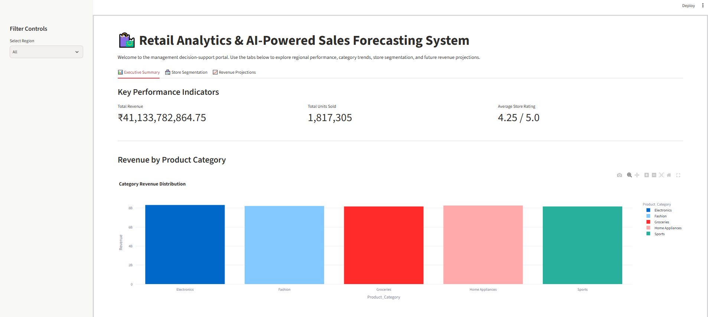
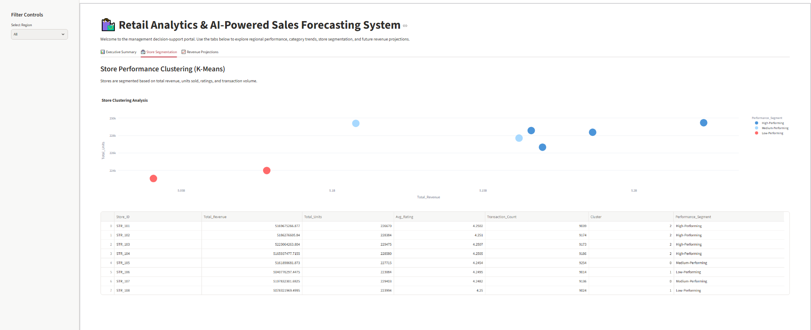
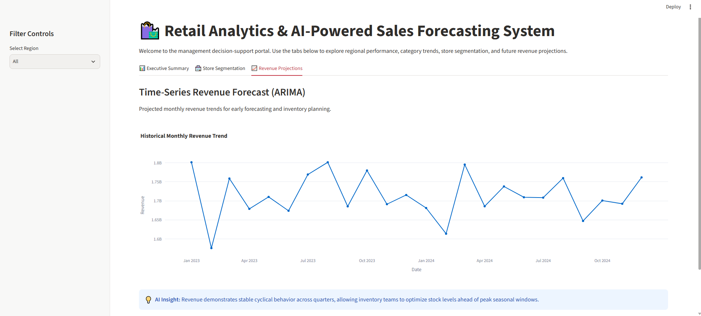
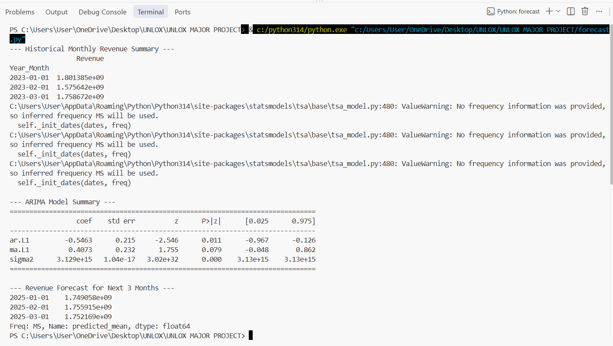
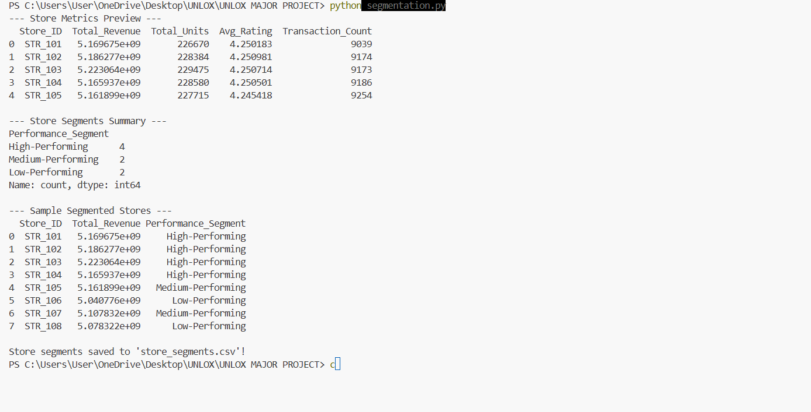

# Retail Analytics & AI-Powered Sales Forecasting System

## 📌 Project Overview
Modern retail organizations collect massive amounts of sales data across multiple locations. This project implements an end-to-end AI-powered decision support tool designed to analyze multi-store retail data, extract key performance metrics, segment retail locations based on performance, and forecast future revenue trends using time-series modeling.

---

## 🚀 Key Features
1. **Exploratory Data Analysis (EDA):** Deep analysis of revenue, unit sales, product category trends, and regional performance.
2. **Visualizations:** Automated generation of trend lines and category bar charts for business evaluation.
3. **Time-Series Revenue Forecasting:** Predictive revenue modeling built with ARIMA (`statsmodels`) to forecast upcoming monthly performance.
4. **Store Performance Segmentation:** Machine learning clustering (`K-Means`) to categorize retail stores into High, Medium, and Low performance tiers.
5. **Interactive Streamlit Dashboard:** An executive decision-support dashboard featuring interactive KPIs, Plotly visuals, and customizable regional filters.

---

## 📂 Project Structure

```text
├── data/
│   └── Retail_Sales_Data_Unlox (1).csv   # Historical sales dataset (2023-2024)
├── eda.py                                # Exploratory Data Analysis script
├── visualize.py                          # Chart generation script
├── forecast.py                           # ARIMA time-series revenue forecasting model
├── segmentation.py                       # K-Means store clustering script
├── app.py                                # Streamlit interactive web application
├── store_segments.csv                    # Output from K-Means store clustering
└── README.md                             # Project documentation
```

---

## 🛠️ Setup & Installation

1. **Clone or Open Project Directory in VS Code:**
   Open VS Code and set the workspace directory to the project folder.

2. **Install Required Dependencies:**
   Run the following command in your terminal to install the necessary libraries:
   ```bash
   pip install pandas matplotlib seaborn scikit-learn statsmodels streamlit plotly
   ```

---

## 💻 How to Run

### 1. Run Data Analysis & Modeling
Execute the standalone Python scripts to process the dataset, train models, and save outputs:

```bash
# 1. Run Exploratory Analysis
python eda.py

# 2. Generate and Save Visualizations
python visualize.py

# 3. Train ARIMA Model & Generate Revenue Forecast
python forecast.py

# 4. Perform Store Segmentation (K-Means)
python segmentation.py
```

### 2. Launch the Interactive Dashboard
To launch the Streamlit decision-support portal:

```bash
python -m streamlit run app.py
```

---

## 📊 Deliverables & Insights
* **Executive Summary:** Overview of aggregate revenues, units sold, and average store ratings.
* **Category Breakdown:** Identification of top revenue-driving product categories.
* **Store Clustering:** Grouped performance data enabling targeted inventory and operational management.
* **Predictive Trends:** Forecasted revenue figures supporting proactive resource allocation.

---

## 📊 Exploratory Data Analysis & Logic
* **`eda.py`**: Performs initial data profiling, checks for missing values, and analyzes distribution patterns across store locations.
* **`visualize.py`**: Contains modular plotting functions used to generate clean trend lines and cluster scatter plots for the dashboard.

---

## 📸 Project Screenshots

### Executive Summary & KPI Dashboard (`app.py`)


### Store Performance Clustering (K-Means)


### Time-Series Revenue Forecasting (ARIMA)


---

## 💻 Console & Model Training Outputs

### ARIMA Time-Series Model Execution Output


### K-Means Store Segmentation Execution Output



---

**Made by Syed Abdul Rahman**